# Site visit assistant

An AI assistant that answers a home buyer in English, Hindi or Gujarati and books a real site visit, with the sales team's lead list, handoff and source dashboard behind it. Built for a real estate developer in Ahmedabad that pays ₹1,000 per lead and misses 35% of its leads for 48 hours or more.

**Live demo:** https://site-visit-assistant-tau.vercel.app/

All names, phone numbers, RERA numbers and figures are made up. No real messages are sent.

## Demo logins

Password for all four: `demo-sitevisit-2026`

| Role | Email | Can see |
|---|---|---|
| Sales head | `head@companya.example` | All leads, dashboard, admin |
| Sales executive | `riya@companya.example` | Own leads only |
| Sales executive | `jay@companya.example` | Own leads only |
| Sales executive | `pooja@companya.example` | Own leads only |

Buyers need no login. When a buyer gives a number, the code appears on screen because this demo has no SMS provider.

## See it working

These were recorded on the live site.

| Buyer on a phone | Sales head on a desktop |
|---|---|
|  |  |
| [Watch as video](docs/video/buyer.mp4) | [Watch as video](docs/video/staff.mp4) |

## Screens

### Buyer

| Project page | Chat | Asking for a discount | Choosing a time |
|---|---|---|---|
| 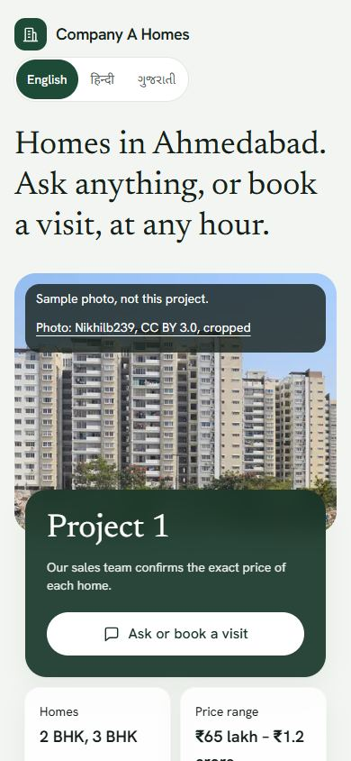 | 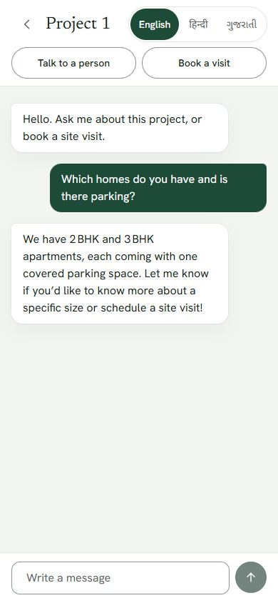 | 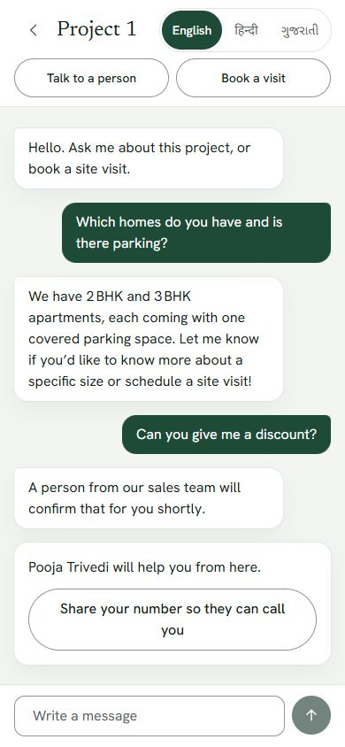 | 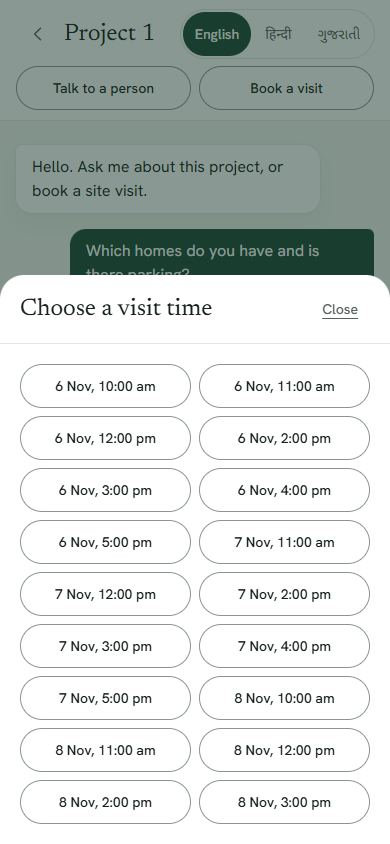 |

| Details and code | Booked | My visit | Hindi | Gujarati |
|---|---|---|---|---|
| 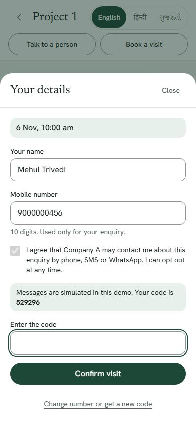 | 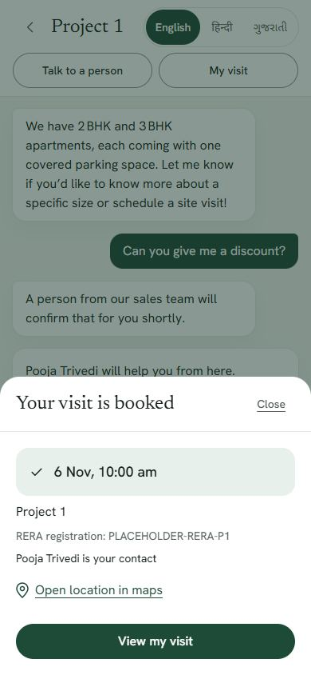 | 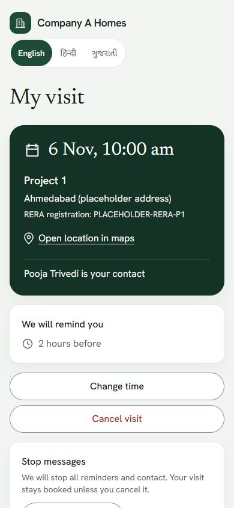 | 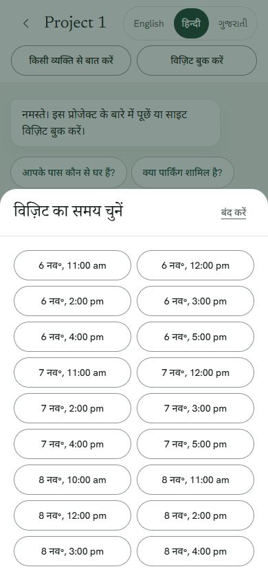 | 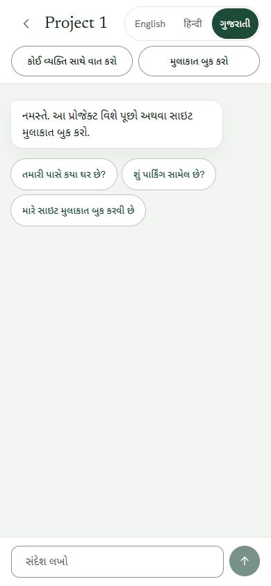 |

### Sales team

**Lead list**
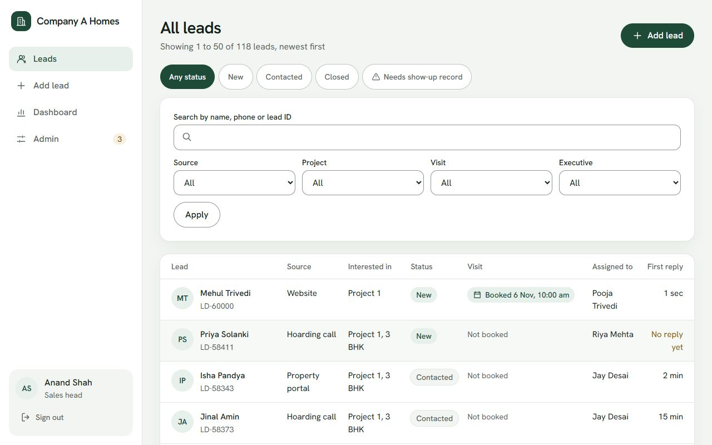

**Lead detail**
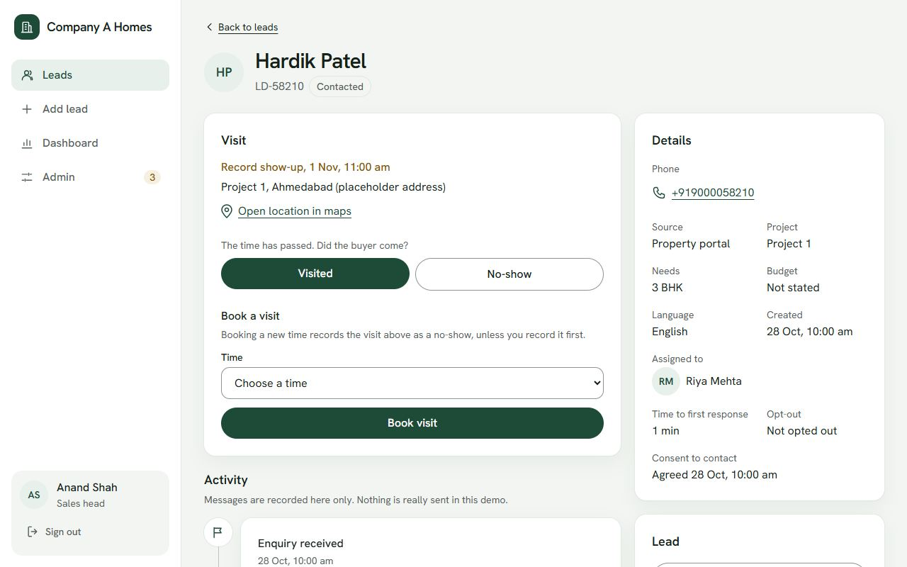

**Source dashboard**
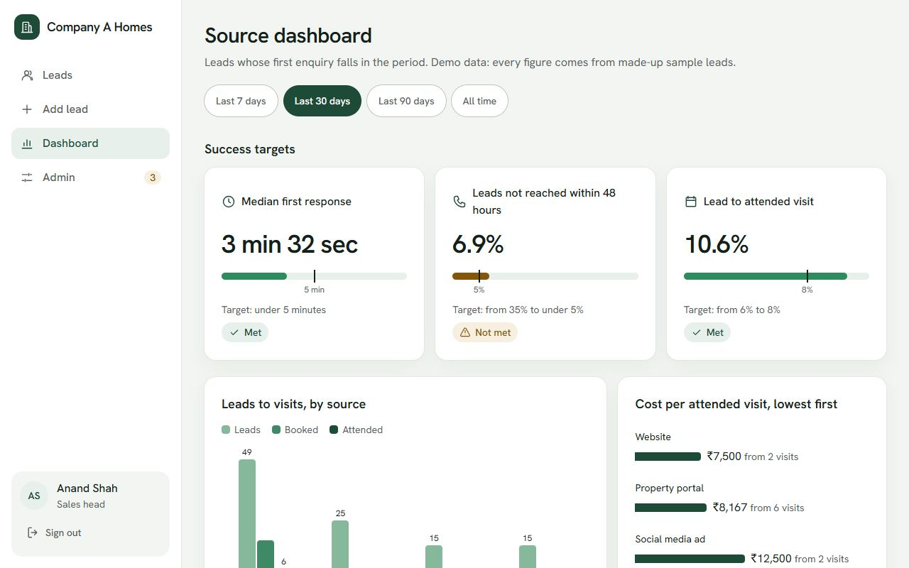

**Admin: fact sheet**
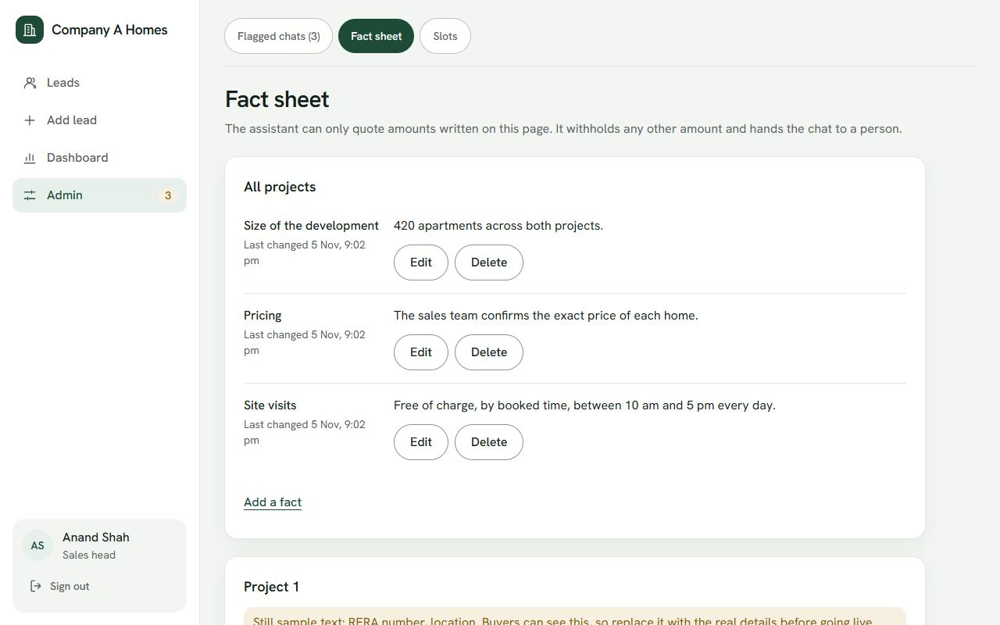

**Admin: visit times**
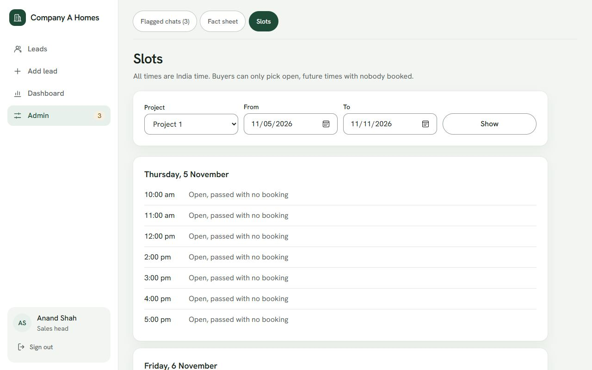

**Admin: flagged chats**
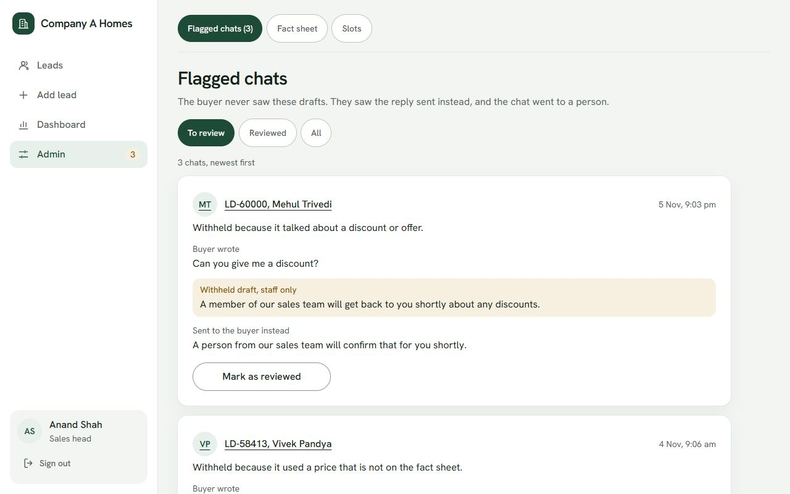

## How the hard parts work

- **No double booking.** Partial unique indexes in Postgres allow one active visit per slot and per lead, and a per-phone lock covers one person on several leads. Parallel requests cannot get past them, and tests run real concurrent bookings.
- **The assistant only says what it knows.** It answers from the sales head's fact sheet. A check in code reads every reply before the buyer sees it and withholds invented numbers, prices and discount talk. The buyer then gets a safe reply and a named person, and the sales head sees the withheld draft.
- **It works when the AI does not.** Free models run in a chain with a fallback, and the booking button never needs the AI.
- **Consent is enforced.** A visit cannot be booked without consent, and an opt-out covers every lead with that phone number.

## Tech

Next.js 16, TypeScript, Tailwind, Drizzle, Postgres (Neon when hosted, Docker locally), Vercel. Free AI models through Groq, with Gemini last in the chain.

## Run it

```bash
docker compose up -d
cp .env.example .env    # then fill in the values
npm install
npm run db:migrate
npm run db:seed
npm run dev
```

Tests: `npm test`. Full setup and deployment steps are in [deployment.md](deployment.md). The reasoning is in the [technical design document](docs/Technical-Design-Document.pdf).

## Photo credits

The project photos are samples of other buildings, and the app labels them that way.

- [Residential Building, Hyderabad](https://commons.wikimedia.org/wiki/File:Residential_Building,_Hyderabad,_20022015.jpg) by Nikhilb239, CC BY 3.0, cropped
- [Tower blocks in Mira Road](https://commons.wikimedia.org/wiki/File:Tower_blocks_in_Mira_Road.jpg) by Sanfy, CC BY-SA 4.0, cropped
